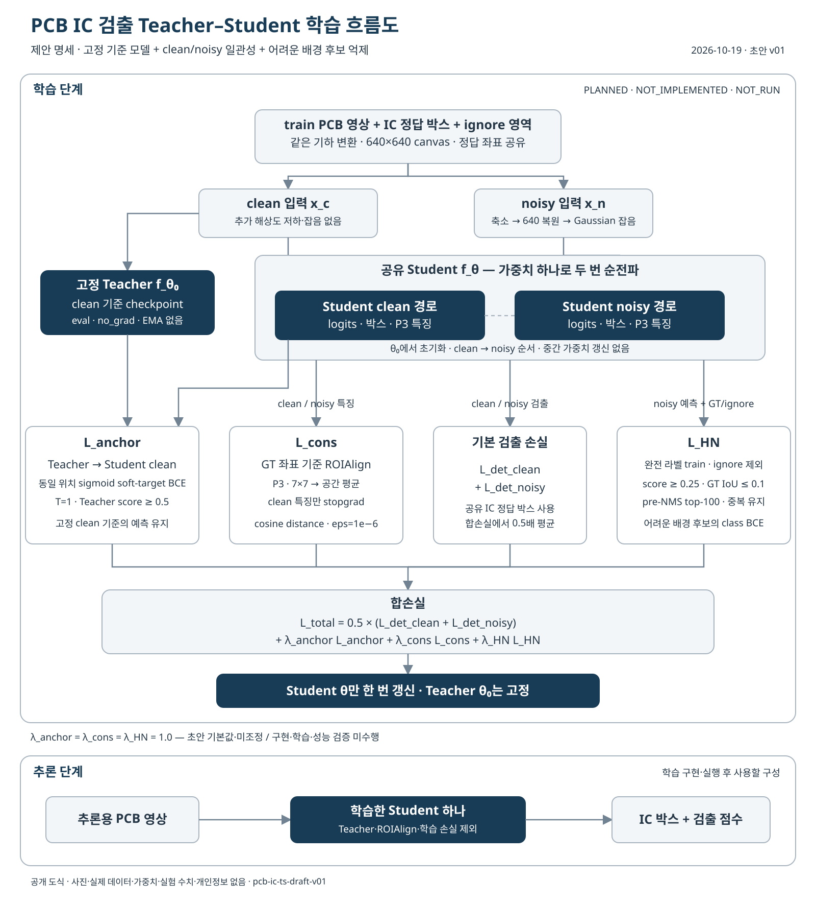

# PCB IC Teacher–Student 강건 검출

**공개 연구 프로토콜 · 2026-10-19 · 초안 v01**

PCB 영상의 IC 위치를 검출할 때, 무잡음 성능을 보존하면서 저해상도·잡음 영상의 검출 성능과 배경 오검출을 개선할 수 있는지 검증한다. 사용자가 제공한 흐름도를 바탕으로 학습 경로, 손실함수, 데이터 분할과 실험 절차를 구체화했다.

현재 공개 범위는 **설계 문서, 설정 초안, 메타데이터 분할 도구, 기록 양식과 새로 그린 다이어그램**이다. 이 방법의 학습기와 세 보조 손실은 아직 구현하지 않았고, 학습·성능 평가는 실행하지 않았다. 성능 수치와 데이터·가중치는 포함하지 않는다.

| 항목 | 상태 | 의미 |
|---|---|---|
| 흐름도 해석·연구 프로토콜 | DRAFT | 구현 전에 검토·동결할 제안 |
| 메타데이터 검사·그룹 분할 도구 | IMPLEMENTED | 표준 라이브러리만 사용; 영상·라벨 내용은 읽지 않음 |
| 실제 데이터 권리·그룹·라벨 검수 | NOT_VERIFIED | 데이터셋별 확인 필요 |
| Teacher baseline·Student 학습기 | NOT_IMPLEMENTED | 기존 검출기를 이 방법의 학습기로 간주하지 않음 |
| L_anchor / L_cons / L_HN | NOT_IMPLEMENTED | 정의와 구현 할 일만 공개 |
| Ablation·독립 평가·실물 카메라 시험 | NOT_RUN | 결과 없음 |

## 알고리즘



Teacher는 무잡음 기준 모델의 고정 가중치 `θ₀`를 사용한다. Student 하나의 `θ`를 무잡음·열화 경로가 공유하며, 두 경로의 검출 손실과 세 보조 손실로 Student만 갱신한다. `L_cons`는 정답 IC 영역에 대응하는 특징을 ROIAlign으로 정렬해 비교한다. 추론 시에는 학습된 Student 한 개만 사용한다. 여기서 무잡음은 **인위적 열화를 추가하지 않은 입력**을 뜻하며, 광학적으로 잡음이 없는 영상이라는 주장은 아니다.

YOLO11의 공식 사용 정보는 [Ultralytics YOLO11 문서](https://docs.ultralytics.com/models/yolo11/)를 참고한다. 구현에 사용할 코드·가중치 버전과 이용조건은 학습 환경을 고정할 때 별도로 확인한다.

## 문서 안내

- [연구 질문·가설·선행연구 토픽](문서/IC검출_연구질문과선행연구_2026-10-19_초안_v01.md)
- [데이터셋 준비·분할·증강 프로토콜](문서/IC검출_데이터준비와분할증강_2026-10-19_초안_v01.md)
- [모듈별 학습 단계](문서/IC검출_단계별학습절차_2026-10-19_초안_v01.md)
- [손실함수 정의·구현 할 일](문서/IC검출_손실함수와구현할일_2026-10-19_초안_v01.md)
- [Ablation 행렬·평가 지표](문서/IC검출_실험행렬과평가지표_2026-10-19_초안_v01.md)
- [공개 범위·출처·기존 프로젝트와의 관계](문서/IC검출_공개범위와자료검토_2026-10-19_검토본_v01.md)
- [설정 초안](configs/IC검출_프로토콜_2026-10-19_초안_v01.json) · [실험 기록 양식](templates/IC검출_실험기록_2026-10-19_양식_v01.md)

## 메타데이터 도구 실행

Python 3.11 이상에서 저장소 루트 기준으로 실행한다. 학습용 라이브러리를 설치하거나 데이터를 자동 다운로드하지 않는다.

```powershell
python -m unittest discover -s research/IC_Teacher_Student/tests -v
python research/IC_Teacher_Student/tools/prepare_manifest.py --input private_manifest.csv --output research/IC_Teacher_Student/local/manifest_split.csv
```

입력 양식은 [헤더만 있는 CSV](templates/IC검출_데이터목록_2026-10-19_양식_v01.csv)를 따른다. 실제 행은 제공하지 않는다. 도구는 메타데이터의 형식과 정확히 같은 해시의 중복을 검사하고 `group_id`별로 분할한다. 영상·라벨의 해시가 사실인지, 기판 그룹이 독립적인지, 권리와 라벨이 적절한지는 사람이 별도로 확인해야 한다. 빈 입력이나 작은 표본에서 세 분할이 생기지 않으면 오류로 중단한다.

위 명령은 학습 실행 명령이 아니다. 실제 데이터 importer, augmentation, trainer, evaluator와 환경 고정은 [학습 절차](문서/IC검출_단계별학습절차_2026-10-19_초안_v01.md)의 미완성 항목이다.

## 폴더 구조

```text
research/IC_Teacher_Student/
├── README.md
├── 문서/              # 연구·데이터·손실·실험·공개 범위
├── configs/           # 실행 전 동결할 설정 초안
├── diagrams/          # 사진 없이 재작성한 SVG와 Mermaid 원문
├── templates/         # 실제 기록이 없는 양식
├── tools/             # 메타데이터만 다루는 분할 도구
├── tests/             # 임시 메타데이터로 도구 동작만 검사
└── local/             # 실제 데이터 목록·분할 결과 보관; Git 제외
```

향후 구현할 모듈은 `dataset_adapter`, `paired_augment`, `teacher_student_trainer`, `losses`, `evaluate`다. 현재는 빈 실행기나 학습 완료를 암시하는 예시 결과를 만들지 않았다.

## 기존 프로젝트와의 관계

기존 [PCB 저장소](../../README.md)의 R03/R04·보드·웨이퍼 이력을 보존하고 이 하위 폴더에 새 방법의 계획을 추가한다. 과거 모델과 개발 평가 점수는 새 Teacher–Student 방법의 구현·성능 근거가 아니다. 이미 사용한 개발 test를 새 독립 최종시험으로 부르지 않는다.

공개 후보 데이터의 원본·라이선스는 각 제공처에서 확인해야 한다. 공개 저장소에 접근할 수 있다는 사실만으로 데이터·논문 그림·모델의 재배포 권한을 가정하지 않는다. 신규 문서에 대한 별도의 포괄 라이선스는 아직 지정하지 않았다.
